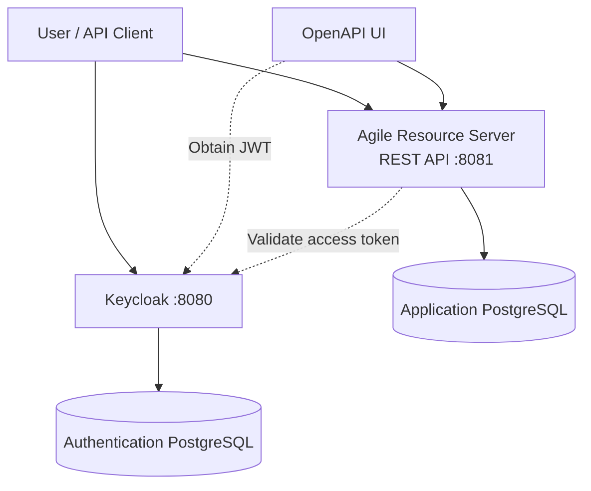

# agile Project

**A Scrum project management web application** for organizing product backlogs, planning sprints, tracking work on a Kanban board, and managing project collaboration with secure, role-based access control.

<p align="center">
  
  
  
  
  
</p>

---

## Table of Contents

- [Overview](#overview)
- [Features](#features)
- [Architecture](#architecture)
- [Technology Stack](#technology-stack)
- [Prerequisites](#prerequisites)
- [Getting Started](#getting-started)
- [Running Tests](#running-tests)
- [Authentication](#authentication)

## Overview

Agile Project provides a centralized workspace for managing Scrum projects, from maintaining the product backlog to tracking sprint execution.

The application separates business API responsibilities from authentication and authorization, using dedicated services and PostgreSQL databases for application and identity data.

## Features

- **Product Backlog Management** — Organize and maintain the work planned for a project.
- **Sprint Planning** — Manage sprints and their associated backlog items.
- **Kanban Board** — Track sprint work by issue status through the API (backend only, no graphical interface in this repository).
- **Project Management** — Organize projects and their related resources.
- **Issue Management** — Create and manage issues throughout the development workflow.
- **Comments** — Support collaboration through issue-related discussions.
- **Sprint Analytics** — Sprint summary report and velocity, burndown and burnup chart data, sprint comparison with date filter and CSV export. Calculation rules and API contract: [`docs/dokumentacja.md`](docs/dokumentacja.md).
- **Role-Based Access Control** — Protect resources using a separate authentication and authorization server.
- **REST API** — Expose application functionality through a documented HTTP API.
- **OpenAPI Documentation** — Explore endpoints and authorize API requests using JWT bearer tokens.

## Architecture

The application consists of a resource server, a dedicated authentication server, and separate PostgreSQL databases.



### Components

| Component | Responsibility | Local endpoint |
|---|---|---|
| `agile-server` | Spring Boot resource server and REST API | `http://localhost:8081` |
| `auth-server` | Authentication and authorization infrastructure | `http://localhost:8080` |
| Application PostgreSQL | Stores application data | Internal Docker network |
| Authentication PostgreSQL | Stores authentication-related data | Internal Docker network |

The services and databases are orchestrated through Docker Compose.

## Technology Stack

| Technology | Purpose |
|---|---|
| Java 21 | Backend runtime |
| Spring Boot | Backend application framework |
| PostgreSQL | Relational database |
| Docker | Containerization |
| Docker Compose | Local multi-service orchestration |
| JWT / Bearer Authentication | API request authentication |
| OpenAPI | REST API documentation |

## Prerequisites

Before starting, ensure you have:

- [Docker](https://docs.docker.com/get-docker/)
- [Docker Compose](https://docs.docker.com/compose/)

**Java 21 is only required if you want to run the Spring Boot module directly on your machine rather than inside Docker.**

## Getting Started

### 1. Clone the repository

```bash
git clone <repository-url>
cd agile-project
```

Replace `<repository-url>` with the URL of your Git repository.

### 2. Create the `.env` file

Docker Compose reads passwords and secrets from `.env`, which is not committed. Create it from the template:

```bash
cp .env.example .env
```

### 3. Start the application

Run the following command from the repository root:

```bash
docker compose -f compose.yaml up --build
```

Docker Compose builds and starts the application services and their database containers.

To run the stack in the background:

```bash
docker compose -f compose.yaml up --build -d
```

To start with demo data for the analytics reports (a project with two finished sprints, issues without
estimation and scope changes), enable the `demo` profile:

```bash
SPRING_PROFILES_ACTIVE=prod,demo docker compose -f compose.yaml up --build
```

The demo project has ID `9001`, its sprints `9001` and `9002`, e.g. `GET /api/analytics/projects/9001/sprints`.
Expected values are listed in `docs/dokumentacja.md` (section "Dane demonstracyjne").

### 4. Verify the services

Once the services have started, the main endpoints are:

| Service | URL |
|---|---|
| Resource server | [http://localhost:8081](http://localhost:8081) |
| Authentication server | [http://localhost:8080](http://localhost:8080) |
| OpenAPI UI (Swagger) | [http://localhost:8081/swagger-ui/index.html](http://localhost:8081/swagger-ui/index.html) |
| OpenAPI specification | [http://localhost:8081/api-docs](http://localhost:8081/api-docs) |

All `/api/**` endpoints require a JWT access token, see [Authentication](#authentication).

### 5. Stop the application

```bash
docker compose -f compose.yaml down
```

To remove the containers and associated Compose-managed volumes, use:

```bash
docker compose -f compose.yaml down -v
```

**Warning:** The `-v` option removes associated volumes and can permanently delete locally stored database data.

## Running Tests

The tests use an in-memory H2 database and need JDK 21:

```bash
./mvnw test
```

Without JDK 21, run them in a Maven container:

```bash
docker run --rm -v "$(pwd):/app" -v maven-repo:/root/.m2 -w /app maven:3.9-eclipse-temurin-21 ./mvnw test
```

### Code coverage

```bash
./mvnw clean verify
```

The JaCoCo report is written to `target/site/jacoco/index.html`. Coverage is measured for all production code without manual exclusions (JaCoCo skips only Lombok-generated code), and the build fails when instruction coverage is below 75%. Current result: 89.37% instruction coverage, 298 tests. Use `clean`, otherwise JaCoCo adds results of previous runs.

## Authentication

Agile Project uses a separate authentication and authorization server to issue access tokens for protected API requests.

### Realm configuration

The authentication server imports its initial realm configuration from:

```text
infrastructure/auth-server/realm-export.json
```

The imported configuration defines the following realm and client:

| Setting | Value |
|---|---|
| Realm | `agile-project` |
| Client ID | `agile-project-server` |
| Token endpoint | `http://localhost:8080/realms/agile-project/protocol/openid-connect/token` |

### Sample accounts

The realm contains two users:

| User | Password | Role | Access |
|---|---|---|---|
| `admin@agile.local` | `admin123` | `sm` (Scrum Master) | all endpoints, including creating and editing projects |
| `developer@agile.local` | `dev123` | `dev` | all endpoints except those restricted to `sm` |

The analytics endpoints (`/api/analytics/**`) are available to both users.

### Calling the API

Get an access token from Keycloak (the client secret comes from `.env.example`; `jq` extracts the token from the JSON response):

```bash
TOKEN=$(curl -s http://localhost:8080/realms/agile-project/protocol/openid-connect/token \
  -d grant_type=password \
  -d client_id=agile-project-server \
  -d client_secret=agile-project-secret \
  -d username=admin@agile.local \
  -d password=admin123 | jq -r .access_token)
```

Send it in the `Authorization` header:

```bash
curl -H "Authorization: Bearer $TOKEN" http://localhost:8081/api/analytics/projects/9001/sprints
curl -H "Authorization: Bearer $TOKEN" -OJ http://localhost:8081/api/analytics/projects/9001/sprints/export.csv
```

In Swagger UI, click **Authorize** and paste the token. Tokens expire after a few minutes; request a new one when the API returns 401.