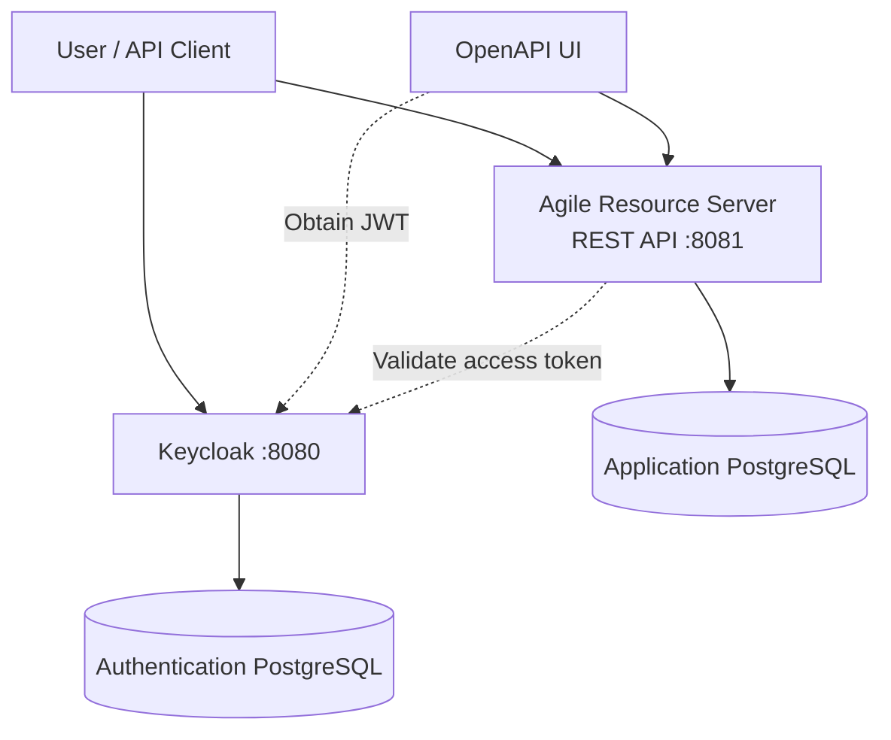

# agile Project

**A Scrum project management web application** for organizing product backlogs, planning sprints, tracking work on a Kanban board, and managing project collaboration with secure, role-based access control.

<p align="center">
  
  
  
  
  
</p>

---

## Table of Contents

- [Overview](#overview)
- [Features](#features)
- [Architecture](#architecture)
- [Technology Stack](#technology-stack)
- [Prerequisites](#prerequisites)
- [Getting Started](#getting-started)
- [Sprint Analytics](#sprint-analytics)
- [Authentication](#authentication)
- [API Documentation](#api-documentation)
- [Useful URLs](#useful-urls)
- [Project Structure](#project-structure)
- [Security Notes](#security-notes)

## Overview

Agile Project provides a centralized workspace for managing Scrum projects, from maintaining the product backlog to tracking sprint execution.

The application separates business API responsibilities from authentication and authorization, using dedicated services and PostgreSQL databases for application and identity data.

## Features

- **Product Backlog Management** — Organize and maintain the work planned for a project.
- **Sprint Planning** — Manage sprints and their associated backlog items.
- **Kanban Board** — Visualize sprint work and track progress through a board-style interface.
- **Project Management** — Organize projects and their related resources.
- **Issue Management** — Create and manage issues throughout the development workflow.
- **Comments** — Support collaboration through issue-related discussions.
- **Role-Based Access Control** — Protect resources using a separate authentication and authorization server.
- **REST API** — Expose application functionality through a documented HTTP API.
- **OpenAPI Documentation** — Explore endpoints and authorize API requests using JWT bearer tokens.

## Architecture

The application consists of a resource server, a dedicated authentication server, and separate PostgreSQL databases.



### Components

| Component | Responsibility | Local endpoint |
|---|---|---|
| `agile-server` | Spring Boot resource server and REST API | `http://localhost:8081` |
| `auth-server` | Authentication and authorization infrastructure | `http://localhost:8080` |
| Application PostgreSQL | Stores application data | Internal Docker network |
| Authentication PostgreSQL | Stores authentication-related data | Internal Docker network |

The services and databases are orchestrated through Docker Compose.

## Technology Stack

| Technology | Purpose |
|---|---|
| Java 21 | Backend runtime |
| Spring Boot | Backend application framework |
| PostgreSQL | Relational database |
| Docker | Containerization |
| Docker Compose | Local multi-service orchestration |
| JWT / Bearer Authentication | API request authentication |
| OpenAPI | REST API documentation |

*The stack above reflects the technologies identified in the project configuration. Additional frameworks and libraries may be present in the individual modules.*

## Prerequisites

Before starting, ensure you have:

- [Docker](https://docs.docker.com/get-docker/)
- [Docker Compose](https://docs.docker.com/compose/)

**Java 21 is only required if you want to run the Spring Boot module directly on your machine rather than inside Docker.**

## Getting Started

### 1. Clone the repository

```bash
git clone <repository-url>
cd agile-project
```

Replace `<repository-url>` with the URL of your Git repository.

### 2. Start the application

Run the following command from the repository root:

```bash
docker compose -f compose.yaml up --build
```

Docker Compose builds and starts the application services and their database containers.

To run the stack in the background:

```bash
docker compose -f compose.yaml up --build -d
```

### 3. Verify the services

Once the services have started, the main endpoints are:

| Service | URL |
|---|---|
| Resource server | [http://localhost:8081](http://localhost:8081) |
| Authentication server | [http://localhost:8080](http://localhost:8080) |
| OpenAPI UI | [http://localhost:8081/docs.html](http://localhost:8081/docs.html) |
| OpenAPI specification | [http://localhost:8081/api-docs](http://localhost:8081/api-docs) |

The API may require authentication for protected endpoints.

### 4. Stop the application

```bash
docker compose -f compose.yaml down
```

To remove the containers and associated Compose-managed volumes, use:

```bash
docker compose -f compose.yaml down -v
```

**Warning:** The `-v` option removes associated volumes and can permanently delete locally stored database data.

## Sprint Analytics

The analytics module (package `io.github.student.agile.analytics`) provides sprint reports and chart data.
All endpoints use the same metric rules from `SprintMetricsCalculator`, so a value such as velocity
is computed in one place only.

### Metric rules (WF-2)

| Rule | Definition |
|---|---|
| Completed issue | An issue whose status is `DONE` (`IssueStatusID.DONE`, id `5`). `TO_DO`, `IN_PROGRESS`, `CODE_REVIEW`, `IN_TESTS` and an issue without status are not completed. |
| Estimation unit | `Issue.estimation`, an integer number of story points (`STORY_POINTS`). |
| Issue without estimation | Counted in the number of issues (completed or not completed), adds 0 story points. A negative estimation is also treated as 0, so point sums are never negative. |
| Sprint scope | Only issues assigned to the given sprint (`Issue.sprint`) are counted. Issues of other sprints or of the backlog are ignored. |
| Velocity | Sum of estimations of completed issues assigned to the sprint. Not completed issues do not increase velocity. A sprint without issues or without completed issues has velocity `0`. |

**Limitation:** the application does not keep a history of estimation changes. Reports use the current
estimation of every issue, so changing an estimation after the sprint has ended also changes the
reported velocity of that sprint.

### Sprint lifecycle and report

Starting a sprint records the initial issue count and estimated story points. Stopping it records
`endDate`, the count and estimated points of incomplete issues, sets `active=false` and `isDone=true`,
and keeps the sprint and its DONE issues. Incomplete issues return to the backlog with status TO_DO.
DONE issues are not modified, preserving their `lastModifiedDate` for chart completion dates.

`GET /api/analytics/sprints/{sprintId}/report` returns `sprintId`, `sprintName`, `projectId`,
`startDate`, `endDate`, `totalIssues`, `completedIssues`, `incompleteIssues`, `velocity`, and
`incompleteEstimation`. Before completion these metrics use the currently assigned issues. After
completion, incomplete counts and points include the snapshot taken at stopping; completed counts and
velocity still use currently assigned issues. Issues added later to a completed sprint are also counted.
Missing sprints return 404 and invalid IDs return 400, with a JSON `status` and `message`.

The `sprint` table gains nullable columns `end_date`, `initial_issue_count`, `initial_estimation`,
`incomplete_issue_count`, and `incomplete_estimation`; the application uses Hibernate `ddl-auto: update`
to add them. Existing data cannot supply historical snapshots: a completed sprint without an incomplete
snapshot cannot produce a reliable report and fails explicitly instead of reporting invented zeros.

### Shared analytics conventions

- Burndown and burnup use `Issue.lastModifiedDate` for completion of DONE issues and the current sum of
  sprint issue estimations as scope; historical scope changes are not reconstructed.
- Sprint comparison lists project sprints with `completedIssueCount`, `incompleteIssueCount`, `velocity`,
  lifecycle `status` (`PLANNED`, `ACTIVE`, `DONE`), and `estimationUnit` `STORY_POINTS`.
- Optional query parameters `from` and `to` (`yyyy-MM-dd`) filter by `Sprint.startDate` inclusively:
  a sprint is included when its `startDate` falls within `[from, to]`. If either parameter is present,
  sprints without `startDate` are excluded. When both are omitted, all project sprints are returned.
  `from` after `to` returns HTTP 400. Results are ordered by ascending `startDate`, then `sprintId`.
- `GET /api/analytics/projects/{projectId}/sprints` returns the filtered comparison as JSON.
  `GET /api/analytics/projects/{projectId}/sprints/export.csv` uses the same filters and writes RFC 4180 CSV
  (`Content-Disposition: attachment; filename="project-{id}-sprints.csv"`). An empty filter result still
  contains the header row.
- Planned endpoints are `/api/analytics/sprints/{id}/burndown` and `/api/analytics/sprints/{id}/burnup`.

## Authentication

Agile Project uses a separate authentication and authorization server to issue access tokens for protected API requests.

### Realm configuration

The authentication server imports its initial realm configuration from:

```text
infrastructure/auth-server/realm-export.json
```

The imported configuration defines the following realm and client:

| Setting | Value |
|---|---|
| Realm | `agile-project` |
| Client ID | `agile-project-server` |
| Token endpoint | `http://localhost:8080/realms/agile-project/protocol/openid-connect/token` |

### Sample accounts

The realm