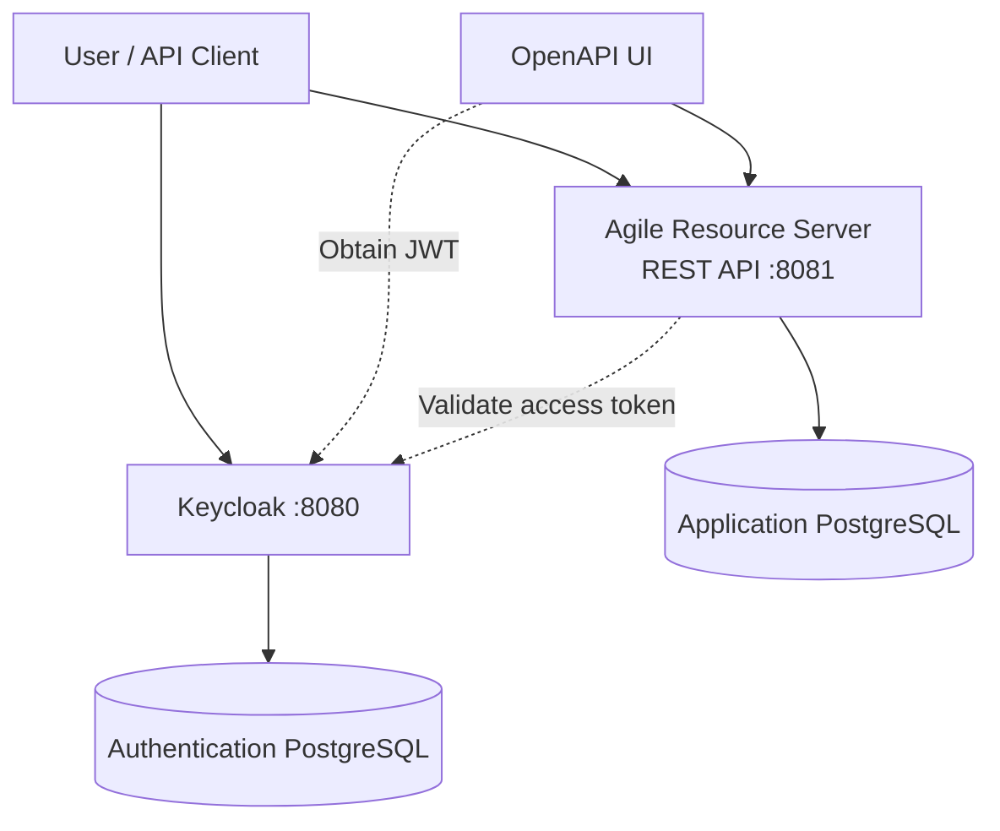

# agile Project

**A Scrum project management web application** for organizing product backlogs, planning sprints, tracking work on a Kanban board, and managing project collaboration with secure, role-based access control.

<p align="center">
  
  
  
  
  
</p>

---

## Table of Contents

- [Overview](#overview)
- [Features](#features)
- [Architecture](#architecture)
- [Technology Stack](#technology-stack)
- [Prerequisites](#prerequisites)
- [Getting Started](#getting-started)
- [Authentication](#authentication)
- [Sprint Analytics & Reporting Module](#sprint-analytics--reporting-module)
- [Architecture Changes & Implementation Notes](#architecture-changes--implementation-notes)
- [Testing & Code Coverage (JaCoCo)](#testing--code-coverage-jacoco)
- [Useful URLs](#useful-urls)
- [Project Structure](#project-structure)
- [Security Notes](#security-notes)
- [Implemented Backlog Issues](#implemented-backlog-issues)

## Overview

Agile Project provides a centralized workspace for managing Scrum projects, from maintaining the product backlog to tracking sprint execution.

The application separates business API responsibilities from authentication and authorization, using dedicated services and PostgreSQL databases for application and identity data.

## Features

- **Product Backlog Management** — Organize and maintain the work planned for a project.
- **Sprint Planning** — Manage sprints and their associated backlog items.
- **Kanban Board** — Visualize sprint work and track progress through a board-style interface.
- **Project Management** — Organize projects and their related resources.
- **Issue Management** — Create and manage issues throughout the development workflow.
- **Comments** — Support collaboration through issue-related discussions.
- **Role-Based Access Control** — Protect resources using a separate authentication and authorization server.
- **REST API** — Expose application functionality through a documented HTTP API.
- **OpenAPI Documentation** — Explore endpoints and authorize API requests using JWT bearer tokens.
- **Sprint Analytics & Reporting** — Sprint summary reports, velocity, burndown/burnup charts, sprint comparison with date filtering, and CSV export.

## Architecture

The application consists of a resource server, a dedicated authentication server, and separate PostgreSQL databases.



### Components

| Component | Responsibility | Local endpoint |
|---|---|---|
| `agile-server` | Spring Boot resource server and REST API | `http://localhost:8081` |
| `auth-server` | Authentication and authorization infrastructure | `http://localhost:8080` |
| Application PostgreSQL | Stores application data | Internal Docker network |
| Authentication PostgreSQL | Stores authentication-related data | Internal Docker network |

The services and databases are orchestrated through Docker Compose.

## Technology Stack

| Technology | Purpose |
|---|---|
| Java 21 | Backend runtime |
| Spring Boot | Backend application framework |
| PostgreSQL | Relational database |
| Docker | Containerization |
| Docker Compose | Local multi-service orchestration |
| JWT / Bearer Authentication | API request authentication |
| OpenAPI | REST API documentation |

*The stack above reflects the technologies identified in the project configuration. Additional frameworks and libraries may be present in the individual modules.*

## Prerequisites

Before starting, ensure you have:

- [Docker](https://docs.docker.com/get-docker/)
- [Docker Compose](https://docs.docker.com/compose/)

**Java 21 is only required if you want to run the Spring Boot module directly on your machine rather than inside Docker.**

## Getting Started

### 1. Clone the repository

```bash
git clone <repository-url>
cd agile-project
```

Replace `<repository-url>` with the URL of your Git repository.

### 2. Start the application

Prepare the local environment variables before starting Docker Compose:

```bash
cp .env.example .env
```

Run the following command from the repository root:

```bash
docker compose -f compose.yaml up --build
```

Docker Compose builds and starts the application services and their database containers.

To run the stack in the background:

```bash
docker compose -f compose.yaml up --build -d
```

### 3. Verify the services

Once the services have started, the main endpoints are:

| Service | URL |
|---|---|
| Resource server | [http://localhost:8081](http://localhost:8081) |
| Authentication server | [http://localhost:8080](http://localhost:8080) |
| OpenAPI UI | [http://localhost:8081/swagger-ui/index.html](http://localhost:8081/swagger-ui/index.html) |
| OpenAPI specification | [http://localhost:8081/api-docs](http://localhost:8081/api-docs) |

The API may require authentication for protected endpoints.

### 4. Stop the application

```bash
docker compose -f compose.yaml down
```

To remove the containers and associated Compose-managed volumes, use:

```bash
docker compose -f compose.yaml down -v
```

**Warning:** The `-v` option removes associated volumes and can permanently delete locally stored database data.

## Authentication

Agile Project uses a separate authentication and authorization server to issue access tokens for protected API requests.

### Realm configuration

The authentication server imports its initial realm configuration from:

```text
infrastructure/auth-server/realm-export.json
```

The imported configuration defines the following realm and client:

| Setting | Value |
|---|---|
| Realm | `agile-project` |
| Client ID | `agile-project-server` |
| Token endpoint | `http://localhost:8080/realms/agile-project/protocol/openid-connect/token` |

### Sample accounts

The realm export includes the following sample accounts for testing:

| Account | Password | Client roles (`agile-project-server`) |
|---|---|---|
| `admin@agile.local` | `admin123` | `sm`, `client_user` |
| `developer@agile.local` | `dev123` | `dev`, `client_user` |

The default Keycloak access token lifetime is `300` seconds. Obtain a token with:

```text
POST http://localhost:8080/realms/agile-project/protocol/openid-connect/token
grant_type=password
```

## Sprint Analytics & Reporting Module

The analytics endpoints are exposed by `SprintAnalyticsRestController`. They require a valid JWT and project membership verified by `UserServiceImpl.verifyProjectAccess`.

| Requirement | Method and path | Response |
|---|---|---|
| `WF-1` | `GET /api/analytics/sprints/{sprintId}/report` | `SprintSummaryReportDTO` |
| `WF-3` | `GET /api/analytics/sprints/{sprintId}/burndown` | `BurndownChartDTO` |
| `WF-4` | `GET /api/analytics/sprints/{sprintId}/burnup` | `BurnupChartDTO` |
| `WF-5`, `WF-6` | `GET /api/analytics/projects/{projectId}/sprints?from=...&to=...` | `List<SprintComparisonItemDTO>` |
| `WF-7` | `GET /api/analytics/projects/{projectId}/sprints/export?from=...&to=...` | CSV file (`text/csv; charset=UTF-8`) |

### Sprint and calculation rules

- The terminal completed status is `IssueStatusID.DONE` (`STATUSID = 5` in `ISSUE_STATUS`, and it is included in `IssueStatusID.COMPLETED_STATUSES`).
- Point metrics use `STORY_POINTS` (`SprintAnalyticsServiceImpl.DEFAULT_ESTIMATION_UNIT`).
- Issues with `estimation == null` are counted in issue counts. Their estimation is `0` in point calculations; negative estimations are also clamped to `0` by `SprintVelocityCalculator.safeEstimation`.
- Velocity is the sum of safe estimations for issues assigned to the requested sprint whose status is `DONE`. Issues outside the sprint or with an incomplete status are ignored.
- Summary and sprint-comparison velocity are calculated from the current estimations of issues currently assigned to the sprint. For completed sprints, incomplete issues use the last snapshot before `SPRINT_STOPPED` when reconstructing a closed sprint.
- `initialIssueCount` is the number of `SPRINT_STARTED` events, or the current sprint issue count when no start event exists.
- For a completed sprint with event history, the count and estimation sum of incomplete issues are reconstructed from the state immediately before `SPRINT_STOPPED`, because unfinished issues return to the backlog with `TO_DO` after sprint stop.

### Burndown and burnup charts

The chart X-axis contains consecutive UTC `LocalDate` values in `yyyy-MM-dd` format, from `startDate` or the earliest event up to the end date: `SPRINT_STOPPED` date for a completed sprint, or the current UTC date for an active sprint. The final date is never earlier than the start date.

The sprint event stream is applied cumulatively through `SPRINT_STARTED`, `ADDED_TO_SPRINT`, `REMOVED_FROM_SPRINT`, `STATUS_CHANGED`, and `ESTIMATION_CHANGED`, stopping at `SPRINT_STOPPED`.

- Burnup `totalScope` is the sum of estimations for issues in the sprint at the end of the day.
- Burnup `completedWork` is the sum of estimations for `DONE` issues at the end of the day.
- Burndown `remainingWork` is `Math.max(0, totalScope - completedWork)`.
- `ADDED_TO_SPRINT` adds an issue from the event day, `REMOVED_FROM_SPRINT` removes it, and `ESTIMATION_CHANGED` updates its estimation.

Without any `sprint_issue_events` entries (legacy data), the implementation does not invent intermediate points. It returns one point for `endDate`, or `startDate` for an active sprint, based on current sprint issues. If the sprint has no start date, it returns an empty point list.

### Sprint comparison and date filtering

Only active (`active == true`) or completed (`isDone == true`) sprints belonging to the requested project are returned, including sprints with zero velocity.

Results are sorted by `startDate` ascending and then by `sprintId`, with null dates ordered last. Optional `from` and `to` parameters use inclusive overlap:

```text
sprintStart <= to && sprintEnd >= from
```

An active sprint with no end date is treated as open-ended. A completed sprint with no end date is treated as a point at `sprintStart`. A sprint with no dates is excluded when a date filter is active.

`DateRangeParser` accepts:

- `yyyy-MM-dd`: `from` starts at UTC `00:00:00Z`; `to` ends at UTC `23:59:59.999999999Z`.
- Full ISO-8601 date-time, for example `2026-11-01T10:15:30Z`. A missing zone or offset is interpreted as UTC.

Invalid formats and `from > to` produce `400 Bad Request` through `InvalidDateRangeException`.

### CSV export

CSV export follows RFC 4180, UTF-8 encoding, comma field separators, and CRLF line endings. Even an empty comparison contains this header:

```text
projectId,sprintId,sprintName,startDate,endDate,completedIssueCount,uncompletedIssueCount,velocity
```

Fields containing commas, quotes, line feeds, or carriage returns are quoted and embedded quotes are doubled (`""`). Dates use `ISO_OFFSET_DATE_TIME`, with `null` represented by an empty field. Export applies exactly the same `from` and `to` overlap rules as comparison.

### HTTP error responses

`GlobalExceptionHandler` and `SecurityConfig` return JSON `ApiErrorResponse` objects containing `timestamp`, `status`, `error`, `message`, and `path`, without stack traces.

| Code | Condition |
|---|---|
| `400 Bad Request` | Invalid date format, `from > to`, or invalid arguments |
| `401 Unauthorized` | Missing, expired, or invalid JWT |
| `403 Forbidden` | Missing role or project access |
| `404 Not Found` | Sprint or project does not exist |

## Architecture Changes & Implementation Notes

1. `Sprint`, `SprintDTO`, and `SprintDTOMapper` include `endDate` (`ZonedDateTime`) to retain sprint completion time.
2. `SprintServiceImpl.stopSprint` keeps completed sprints in the database instead of deleting them, retains completed issues on the sprint, returns unfinished issues to `TO_DO`, and stores start/add/remove/stop events.
3. `IssueServiceImpl` compares issue status using `IssueStatusID::isCompleted` in `getBacklogHistory` and records status and estimation change events in `changeIssueStatus` and `updateIssue`.
4. `UserServiceImpl` provides `hasProjectAccess` and `verifyProjectAccess` for project isolation.
5. `SecurityConfig` formats `401` and `403` responses as `ApiErrorResponse`.
6. Application and test SQL data use a consistent PostgreSQL dictionary setup (`AOA`, `platform: postgres`).

The new model includes `SprintIssueEvent`, `SprintEventType`, the analytics controller/service/event service, `SprintVelocityCalculator`, analytics DTOs, `DateRangeParser`, `SprintComparisonCsvExporter`, global error handling classes, and analytics-specific exceptions. Hibernate `spring.jpa.hibernate.ddl-auto: update` plus `spring.sql.init` scripts manage schema/data; there is no separate Flyway or Liquibase migration.

For `WNF-5`, sprint comparisons load issues and events in bulk (`findAllBySprintIdIn`, `findAllBySprintIdInOrderByOccurredAtAscIdAsc`) and group them in memory to avoid N+1 queries.

## Testing & Code Coverage (JaCoCo)

Run the complete Maven verification with:

```bash
mvn -B verify
```

The HTML coverage report is written to `target/site/jacoco/index.html`. GitHub Actions also uploads a `jacoco-report` artifact.

JaCoCo enforces at least 75% instruction coverage (`INSTRUCTION COVEREDRATIO >= 0.75`) during `verify`. The report excludes `io/github/student/agile/AgileServerApplication.class` and `io/github/student/agile/config/**`. Lombok-generated code is ignored automatically.

| Metric | Result |
|---|---|
| Tests | **205 / 205** passed (`0` failures) |
| Instruction coverage | **86.30%** (`4446 / 5152`) |
| Branch coverage | **78.82%** (`320 / 406`) |
| Line coverage | **86.67%** (`1014 / 1170`) |

## Useful URLs

| Resource | URL |
|---|---|
| Resource Server | `http://localhost:8081` |
| Swagger UI | `http://localhost:8081/swagger-ui/index.html` |
| OpenAPI JSON | `http://localhost:8081/api-docs` |
| Keycloak Auth Server | `http://localhost:8080` |

## Project Structure

```text
resource/
  controller/
  service/
  repository/
  domain/
  dto/
exception/
security/
utils/
infrastructure/auth-server/
client/http/
```

## Security Notes

Local secrets are kept in `.env`, which is ignored by Git. `.env.example` provides safe local placeholders. API authentication uses JWT bearer tokens issued by Keycloak. Protected operations use role authorization (`@PreAuthorize`), and project-scoped operations verify membership with `UserServiceImpl.verifyProjectAccess`.
